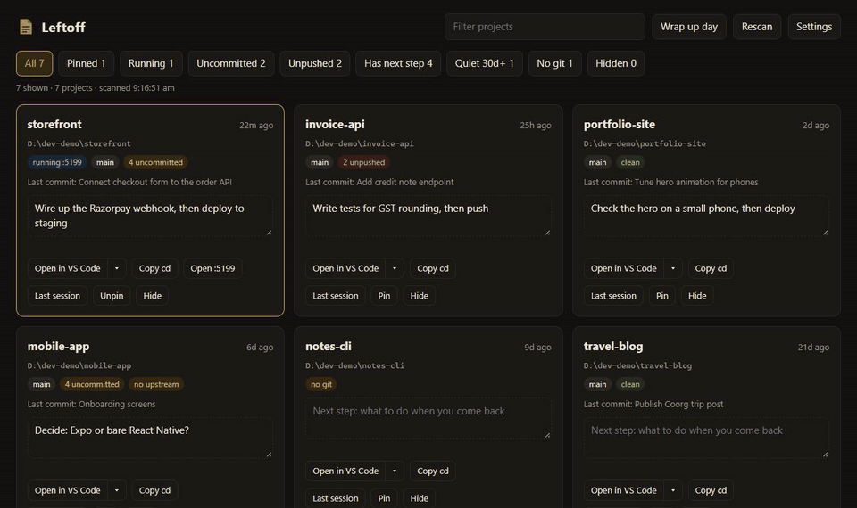
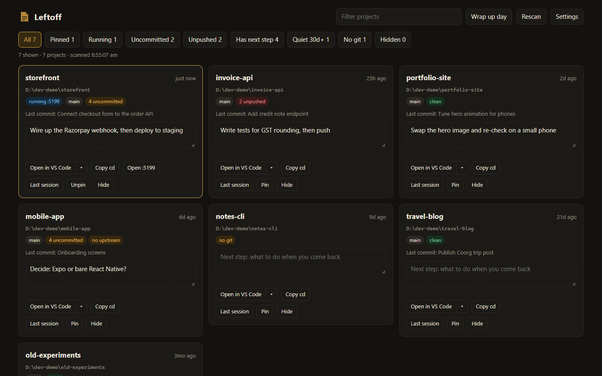
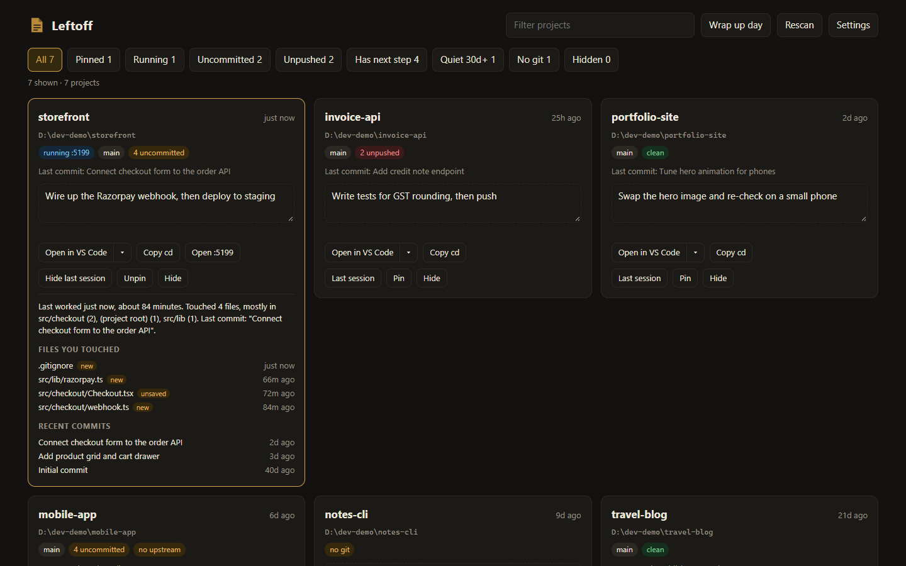
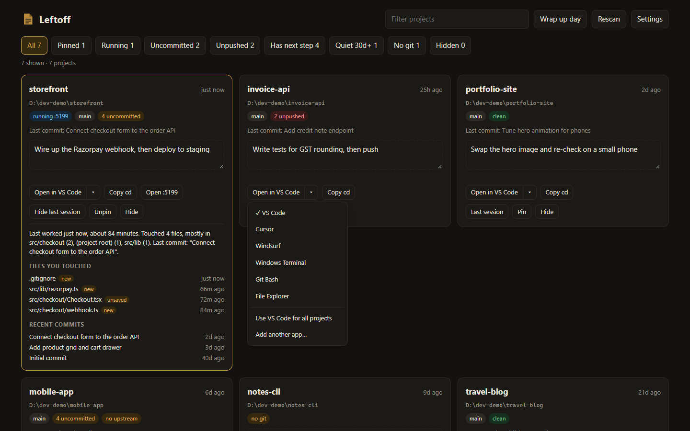

<p align="center"></p>

# Leftoff

**See where you left off in every project.**

<p align="center"></p>

When you juggle many project folders, coming back to one after a few weeks is slow. Was anything unsaved? Did you push? Is a dev server still running? What were you about to do?

Leftoff shows all your projects on one board. Each card tells you:

- **When you last touched it**
- **Git state**: branch, uncommitted files, unpushed commits, commits behind, missing upstream
- **What is running**: dev servers on localhost, matched to the project that started them, with an "Open :5173" button
- **Your next step**: a note you leave yourself, waiting for you when you return
- **Last session**: the files you touched last time, recent commits, and a plain-language summary like *"Last worked 32h ago, about an hour. Touched 9 files, mostly in src (8)."*

Everything stays on your computer. No account, no cloud, no telemetry.

## Start in under a minute

You need [Node.js](https://nodejs.org) 18 or newer and git.

**One line:**

```sh
npx @galvora-labs/leftoff
```

Or install it once and run `leftoff` any time:

```sh
npm install -g @galvora-labs/leftoff
leftoff
```

**Or from a download**, on Windows: double-click `start-leftoff.cmd`. On any system:

```sh
node bin/leftoff.js
```

The first time, Leftoff asks **"Which folder holds your projects?"** and shows a folder picker. No typing paths. It finds every project inside, remembers the folder, and next time opens straight to your board. Running it again while it is already open just brings the page back up.

| The board | Last session | Choose how to open |
|---|---|---|
|  |  |  |

Screenshots use sample projects.

## Using the board

| You want to | Do this |
|---|---|
| Leave yourself a reminder | Type in the box on a card. It saves when you click away. |
| Open the project | Click **Open in VS Code** (or whichever app is your choice). The arrow beside it lists every app Leftoff found: VS Code, Cursor, Windsurf, Zed, Sublime Text, Notepad++, Windows Terminal, Git Bash, File Explorer. Pick one and it becomes that project's default. **Use X for all projects** sets it everywhere. |
| Use an app that is not listed | Menu, **Add another app...**, then pick its program file (an .exe on Windows). |
| See what you did last time | Click **Last session** on a card. |
| Keep important projects on top | **Pin**. |
| Declutter | **Hide** (find them again under the **Hidden** filter). |
| Find something | Use the filter buttons (Running, Uncommitted, Unpushed, Has next step, Quiet 30d+, No git) or the search box. |
| End the day cleanly | **Wrap up day** lists everything you touched today so you can leave a next step for each. After the reminder time (6 PM by default) a banner offers this while the page is open. Change the time or turn it off in **Settings**. |
| Add or remove project folders | **Settings**. |

### From the terminal

```sh
leftoff list                       # table of every project
leftoff note shop "wire up the checkout webhook"
leftoff add ~/projects             # remember a folder
leftoff list --json                # for scripts
```

Options: `--port <n>` (default 4747), `--depth <n>` (how deep to look, default 3), `--no-open`, `--no-ports`.

## How it decides what a project is

A folder counts as a project when it contains `.git`, `package.json`, `pyproject.toml`, `requirements.txt`, `Cargo.toml`, `go.mod`, `pubspec.yaml`, `pom.xml`, `build.gradle`, `composer.json`, `Gemfile` or `index.html`. Leftoff does not search inside a project for more projects and skips `node_modules`, `dist`, `build`, `venv` and dot-folders. A generic name (`mobile`, `app`) or a name shared by two folders is shown as `parent/name`.

## How "last session" works

Leftoff lists the files in the project (respecting `.gitignore`), sorts them by modified time, and treats edits less than two hours apart as one working session. The summary is built from that, from your recent commits and from the folders involved. It is simple rules, not AI, so it is instant and never invents anything. Build artifacts that git does not ignore (such as `*.tsbuildinfo`) can show up in the list.

## How "running" is detected

1. Listening sockets are read with `netstat` (Windows) or `lsof` (macOS, Linux) and tied to a project through the process command line or working directory.
2. Some machines hide sockets from `netstat` (VPN or virtual network drivers). As a fallback, Leftoff reads the port from the command line of processes that point into a project (`--port 5188`), or tries the tool's usual port (Vite 5173-5178, Next 3000, and so on), and confirms with a quick local connection.

Limits:

- Detection is best effort. A dev server whose command line does not include the project path may be missed.
- If two projects could both own a guessed default port, Leftoff shows neither rather than guessing.
- Windows 11 is the tested platform. macOS and Linux code paths exist (app detection, `lsof`) but have not been tested on those systems. Reports and fixes welcome.
- Windows Terminal and Git Bash open at the project folder. Apps that are only installed as `.cmd` launchers must be added with their real program file.

## Where data lives

Notes, pins, hidden projects, chosen apps and folders are plain JSON in `~/.leftoff/`. Set `LEFTOFF_HOME` to use another folder. Leftoff never writes inside your projects.

## Security

The board listens on `127.0.0.1` only. Requests must carry a matching `Host` header (blocks DNS rebinding). Anything that writes, opens a program or browses folders needs a random per-run token that only the served page knows (blocks other websites from calling it). "Open" works only for projects Leftoff found, and custom apps must be an existing program file you chose.

## Tests

```sh
npm test
```

## License

MIT. See [LICENSE](LICENSE). Built by [Galvora Labs](https://galvoralabs.com).
